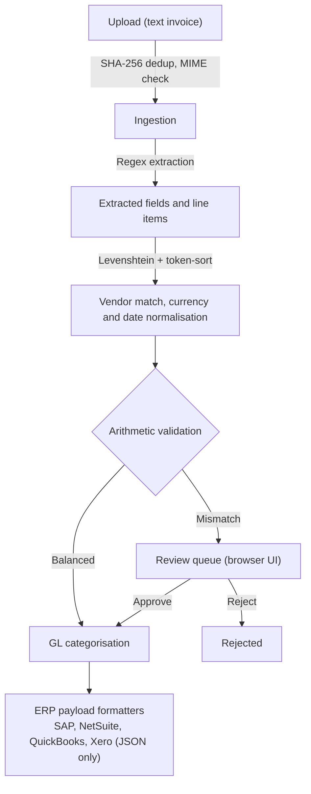
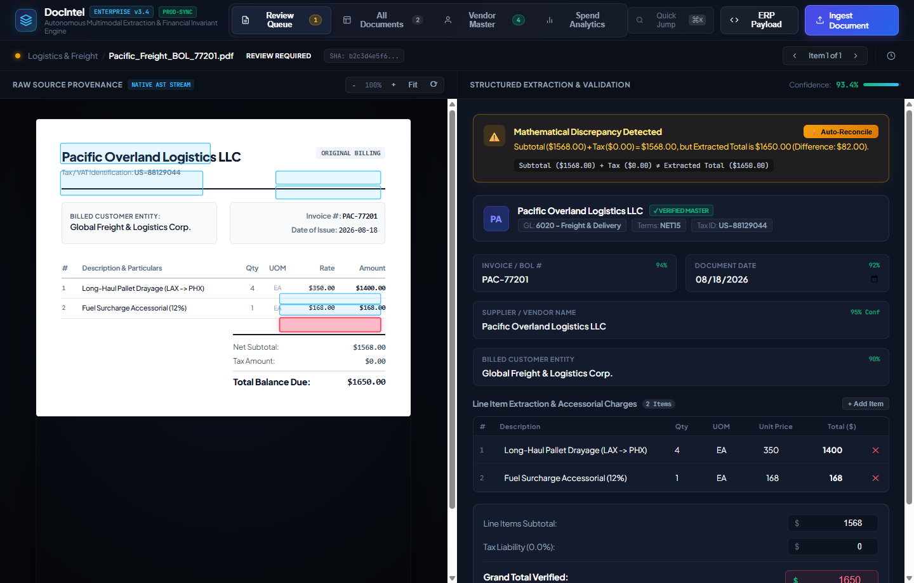
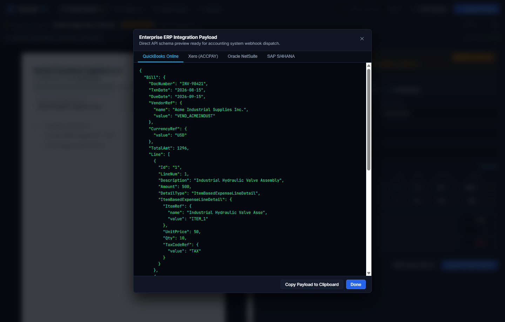
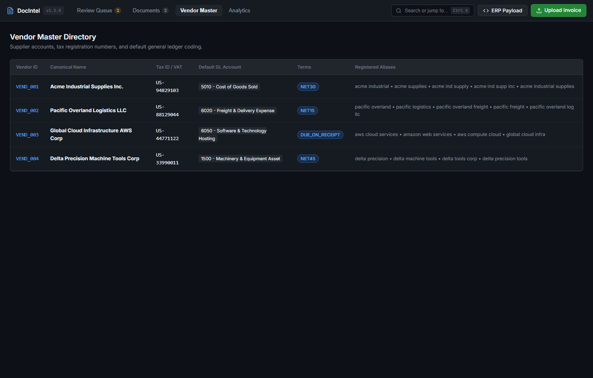
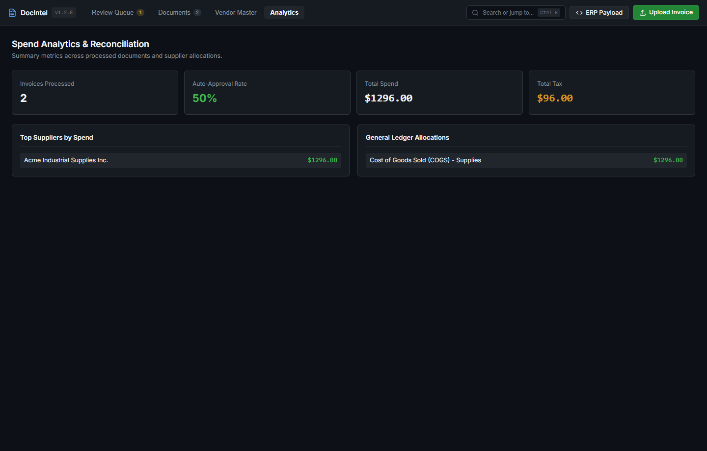

# DocIntel

> A rule-based invoice checker for accounts-payable demos: it pulls fields and line items out of text invoices and UBL 2.1 XML, re-checks the arithmetic, fuzzy-matches the vendor, and formats ERP-shaped JSON for review.

**Status:** Prototype (Aug 2026) · Node.js, zero runtime dependencies · 24 passing tests (`npm test`)
**Demo:** screenshots below; no live demo

## Architecture



Code lives in `src/` (`ingestion`, `extraction`, `normalization`, `validation`, `categorization`, `export`, `reporting`, `telemetry`, `backend`, `frontend`). State is held in memory.

## What it does

- **Arithmetic checks** (`src/validation/validationEngine.js`): sum of lines vs subtotal, subtotal + tax - discount (and shipping) vs total, quantity x unit price vs line amount, tolerance 0.01.
- **Vendor matching** (`src/normalization/vendorMatcher.js`): Levenshtein distance plus token sorting against a vendor master hard-coded in that file.
- **Ingestion** (`src/ingestion/ingestionService.js`): SHA-256 duplicate detection (HTTP 409), 25 MB limit, PDF/PNG/JPEG magic-byte detection.
- **UBL 2.1 XML parser** (`src/ingestion/eInvoiceParser.js`), covered by a unit test but not reachable through the upload endpoint (see Limitations).
- **ERP payload formatters** (`src/export/*Adapter.js`): build SAP BAPI, NetSuite VendorBill, QuickBooks Bill and Xero ACCPAY JSON objects. Each has a unit test; conformance to the vendors' real schemas has not been checked.
- **Review UI** (`src/frontend`): side-by-side view, editable line items, "Auto-balance" button, keyboard shortcuts (`Alt+A` approve, `Alt+R` reject, `Alt+N`/`Alt+P` next/previous, `Ctrl+K` search).
- **Metrics and health:** `/api/health`, `/api/metrics?format=prometheus`.

## Screenshots

| Review workspace | ERP export |
| :-- | :-- |
|  |  |
|  |  |

The boxes drawn on the document in the review workspace are fixed positions, not detected coordinates.

## Quickstart

Requires Node.js 18 or newer. There are no dependencies to install.

```bash
git clone https://github.com/HamzaKhanBUIC/doc-intel-platform.git
cd doc-intel-platform
npm start
```

Open `http://localhost:3344`.

## Configuration

| Variable | Default | Purpose |
| :-- | :-- | :-- |
| `PORT` | `3344` | HTTP port used by `start.js` |

## Testing

```bash
npm test                 # 24 tests (node:test)
npm run benchmark        # 3 hand-written cases
node scripts/evaluation/iterate_and_benchmark.js   # 50 synthetic invoices; random noise, results vary per run; rewrites docs/ITERATION_BENCHMARK_REPORT.md
node scripts/evaluation/run_load_test.js           # 100 uploads against a local server
```

Timings from these scripts are single-machine, in-process or loopback figures on short synthetic text, so no throughput or latency numbers are quoted here.

## REST API

| Endpoint | Method | Description |
| :-- | :-- | :-- |
| `/api/documents/upload` | POST | Upload a document (body is read as UTF-8 text) |
| `/api/documents` | GET | List documents, optional status filter |
| `/api/documents/:id` | GET | Document data and audit trail |
| `/api/review-queue` | GET | Documents waiting for review |
| `/api/documents/:id/review` | POST | Approve or reject, with edits |
| `/api/vendors` | GET | Vendor master and default GL accounts |
| `/api/reports/summary` | GET | Spend, tax and category totals |
| `/api/export?format=<erp>` | GET | `quickbooks`, `xero`, `netsuite`, `sap`, `csv` |
| `/api/metrics?format=prometheus` | GET | Prometheus metrics |
| `/api/health` | GET | Health check |

## Limitations

- **No OCR and no PDF parsing.** The upload body is decoded as UTF-8 text (`src/backend/server.js`). It only works on plain-text invoices such as the test fixtures. Real PDFs, scans, PNG and JPG produce garbage text.
- **Fixed bounding boxes.** Field boxes are constants in `src/extraction/extractionEngine.js`; line-item positions come from the line index.
- **Invented invoice number.** When no invoice number is found, the extractor generates a random `INV-nnnnn` (`extractionEngine.js:90`) instead of failing. The UBL parser has a similar `Date.now()` fallback.
- **ERP formatters make no network calls.** Nothing is sent to SAP, NetSuite, QuickBooks or Xero.
- **UBL XML upload is rejected** by `/api/documents/upload` (XML is missing from the allowed MIME list); the parser is only exercised by its unit test.
- **Synthetic benchmarks.** The 50 "fixtures" are strings built from one template (all USD, one layout), not real invoices.
- **Not hardened for hosting.** No authentication; the review endpoint merges client-supplied fields into the record; upload bodies are buffered in memory before the size check; the review UI inserts filenames and extracted text into `innerHTML` without escaping (stored XSS); CORS is `*`. Run it locally only.
- Data is in memory and resets on restart. No CI.
- `package.json` says `ISC` while `LICENSE` is MIT.

## License

MIT, see [LICENSE](LICENSE).
